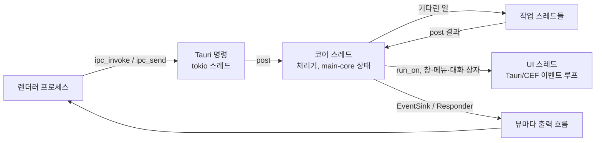

# 3단계 셸 계약

- 날짜: 2026-11-13
- 근거: 결정 [0025](decisions/0025-Rust-전환.md)(Rust 전환), [0026](decisions/0026-화면은-React로-남긴다.md)(화면은 React), [0029](decisions/0029-껍데기-선택.md)(껍데기는 Tauri 3의 CEF 런타임, 조건부), [0030](decisions/0030-중심-프로세스-Rust.md)(중심 프로세스는 `main-core`)
- 코드: `crates/shell-contract`(타입과 trait), `crates/shell-ipc/{u,a,m,w,d1,d2}`(묶음마다 빈 등록 함수), `tools/shell-inventory/channels.ts`(채널 목록과 묶음 나누기)

3단계는 Electron을 걷어 낸다. 일을 여러 묶음으로 나눠 한꺼번에 돌리려면 묶음들이 함께 기대는 것을 먼저 정해야 한다. 이 문서가 그것이다. 셸의 모양, IPC 경계, 스레드, 공용 타입, preload를 다시 만드는 법, 그리고 묶음 표와 받아들이는 조건을 정한다. 묶음의 구현은 이 문서에 없다.

## 1. 셸의 모양

- **실행 파일 하나.** `crates/shell`(나중에 W 묶음이 만든다)이 Tauri 3 + `tauri-runtime-cef` 앱이다. 판은 0029 3항대로 고정한다. 이 프로세스가 브라우저 프로세스이고, CEF가 렌더러·GPU·유틸리티 프로세스를 같은 실행 파일로 다시 띄운다.
- **`main-core`는 같은 프로세스 안에 산다.** 애드온도 사이드카도 아니다. `main-node`와 같은 자리에서 `main-core`를 라이브러리로 링크한다. `main-core`는 여전히 껍데기를 모른다(`crates/main-core/tests/hosts.rs`).
- **창과 뷰.** Electron의 `BrowserWindow`는 Tauri 창, `webContents`는 웹뷰다. 셸 창의 탭은 `WebContentsView`였으므로 창 하나에 웹뷰가 여럿이다. 식별자는 Electron의 뜻을 그대로 쓴다(`WindowId` = `BrowserWindow.id`, `ViewId` = `webContents.id`).
- **화면 묶음.** 렌더러 묶음은 지금처럼 앱 스킴(`renderer-protocol`)으로 싣는다. Tauri의 사용자 스킴 처리기로 옮긴다(W). CEF는 사용자 스킴을 `http://<스킴>.localhost`로만 내주므로 페이지는 `http://genoffice-app-<host>.localhost/...`에서 뜨고, 처리기는 지금처럼 `genoffice-app://<host>/...`를 본다(`crates/shell/src/app_scheme.rs`가 양쪽을 바꾼다).
- **panic.** 작업 공간의 release 프로필은 `panic = "abort"`다. 셸은 `main-node`처럼 `panic = "unwind"` 프로필로 짓고, 처리기 호출마다 `catch_unwind`로 감싸 오류 답으로 바꾼다(0030 2항과 같은 이유). panic이 셸을 끝내면 열린 문서가 모두 닫힌다.

## 2. IPC 경계

### 렌더러 쪽은 바꾸지 않는다

렌더러와 preload 소스는 그대로 둔다. preload는 `ipcRenderer.invoke/send/sendSync/on`과 `contextBridge.exposeInMainWorld`를 부른다. 셸은 이 두 객체를 같은 모양으로 만들어 주는 브리지(`crates/shell/bridge/electron.ts`, W)를 두고, 각 preload를 `electron` → 브리지로 바꿔 묶어 그 웹뷰의 초기화 스크립트로 싣는다(4절).

### 채널 이름이 곧 열쇠다

Tauri 명령을 채널마다 하나씩 만들지 않는다. 셸의 Tauri 명령은 셋이다.

| 렌더러 호출                         | 셸 쪽                                                                         | 답                                                                                      |
| ----------------------------------- | ----------------------------------------------------------------------------- | --------------------------------------------------------------------------------------- |
| `ipcRenderer.invoke(ch, ...args)`   | 명령 `ipc_invoke { id, channel, args }` → 코어 스레드의 처리기                | 명령은 바로 받았다고만 답한다. 처리기의 답은 그 뷰의 출력 흐름으로 `{reply: id}`로 간다 |
| `ipcRenderer.send(ch, ...args)`     | 명령 `ipc_send { channel, args }` → 같은 처리기 표                            | 없음. 실패는 기록만                                                                     |
| `ipcRenderer.sendSync(ch, ...args)` | `http://seuoffice-ipc.localhost/<ch>`로 가는 동기 XHR(CEF의 사용자 스킴 주소) | 응답 본문. 채널은 하나(`docs:context-menu-claim`)                                       |
| `ipcRenderer.on(ch, fn)`            | 뷰마다 하나인 출력 흐름(Tauri `ipc::Channel`)을 브리지가 처음에 연다          | `{event: ch, args}`를 받아 듣는 함수에 `(event, ...args)`로 넘긴다                      |
| `postMessage`(포트)                 | 쓰는 렌더러가 없다                                                            | -                                                                                       |

까닭. 채널이 1,101개다. 이름을 그대로 열쇠로 쓰면 preload, 비교 틀, 처리기가 같은 이름을 쓰고, 렌더러를 고칠 일이 없다. Tauri의 명령별 권한(capability) 대신 셸이 채널 표의 `surfaces`로 막는다(아래).

### 순서

Electron은 `webContents.send`와 `invoke`의 답을 한 파이프로 보내서, 스트림 조각이 그것을 만든 invoke의 답보다 먼저 닿는다. Tauri에서는 명령의 응답과 이벤트가 다른 길로 간다. 그래서 **답도 이벤트도 뷰마다 하나인 출력 흐름(`ipc::Channel`)으로만 보낸다.** 그 흐름은 보낸 순서대로 닿는다. 명령 `ipc_invoke`의 응답은 받았다는 표시뿐이다. 큰 답이 그 흐름에서 한 번 더 왕복하는 비용은 W가 0029의 IPC 측정(1 KB, 10 MB)으로 다시 잰다.

### 값

`IpcValue`(`crates/shell-contract/src/value.rs`)가 경계를 넘는 값이다. Electron의 구조화된 복제 가운데 렌더러가 쓰는 부분이다. `undefined`, `null`, 불, 수(`NaN`, 무한, `-0` 포함), 문자열, 바이트(`ArrayBuffer`, `Uint8Array`), 날짜, 배열, 키 순서를 지키는 객체. JSON만 쓰면 `undefined`, 바이트, 날짜가 사라지고 비교 틀이 차이를 본다.

선 위의 모양은 메시지 하나가 JSON 머리 하나와 바이트 버퍼들이다(Tauri 3의 raw 본문). 머리 안의 특수 값은 태그 객체로 쓴다.

| 값                                   | 머리에서                                     |
| ------------------------------------ | -------------------------------------------- |
| `undefined`                          | `{"$":"u"}`                                  |
| 바이트                               | `{"$":"b","k":"u8"\|"ab","i":n}`(n번째 버퍼) |
| 날짜                                 | `{"$":"d","v":ms}`                           |
| `NaN`, `Infinity`, `-Infinity`, `-0` | `{"$":"n","v":"NaN"}` 등                     |
| 키 `$`를 가진 보통 객체              | `{"$":"o","v":{…}}`                          |

`Map`, `Set`, 다른 형식 배열을 만나면 그 묶음이 우회하지 않고 계약을 고친다(9절). JavaScript 문자열의 짝 없는 서로게이트는 Rust `String`에 담기지 않는다. 0030이 `main-diff`에서 본 것과 같은 한계이고, 만나면 `divergences.json`에 적는다.

### 오류

처리기의 실패는 `IpcError { name, message }`다. Electron은 렌더러에 던진 값의 글만 넘긴다. 렌더러가 받는 것은 `Error invoking remote method '<ch>': <String(err)>`이고, `String(err)`는 `name: message`다. 브리지는 이 문장을 그대로 만든다(`IpcError::remote_message`). 등록되지 않은 채널은 Electron처럼 `Error: No handler registered for '<ch>'`다. panic은 `name: "Error"`에 panic 글을 담아 답한다.

### 취소

Electron의 `invoke`는 렌더러가 취소할 수 없다. 앱은 따로 취소 채널을 둔다(`ai:stream-cancel` 같은 것). 그것은 보통 채널로 남는다. 셸이 더하는 것은 하나다. 처리기가 받는 `CallContext::cancel`은 보낸 뷰가 없어지거나 다른 페이지로 가면 켜진다. `abort-on-destroyed`가 하던 일이다. 답을 기다리던 뷰가 없으면 답은 버린다.

### 스트리밍

지금과 같다. 처리기가 `EventSink::emit(Target::View(sender), ch, args)`로 조각을 보내고, 끝에 `Responder`로 답한다. 순서는 위 "순서"가 지킨다. 대상은 뷰 하나, 창 하나, 같은 preload를 쓴 모든 뷰, 모든 뷰 가운데 하나다(`Target`).

### 권한

채널 표의 `surfaces`는 그 채널에 닿는 preload 목록이다. 셸은 그 밖의 웹뷰가 보낸 메시지를 거절한다. Electron에는 없던 검사다. 앱 스킴이 아닌 주소(바깥 웹 페이지)를 띄운 웹뷰에는 브리지를 싣지 않는다.

## 3. 스레드와 이벤트 루프

- **UI 스레드.** Tauri/CEF 이벤트 루프다(macOS는 주 스레드). 창, 메뉴, 대화 상자, 클립보드만 여기서 만진다. 여기서는 아무것도 기다리지 않는다.
- **코어 스레드 하나.** 모든 처리기가 여기서 도착한 순서대로 하나씩 돈다. Electron의 주 스레드가 모든 `ipcMain` 듣는 함수를 돌리던 것과 같다. 그래서 `main-core`의 상태(`Rc`, `RefCell`을 쓰는 `Updater`, `RecoveryStore`, `RendererWatchdog` 등)에 잠금이 필요 없고, `main-core`의 공개 trait를 바꿀 일도 없다. `Handler`가 `Send`가 아닌 것도 이 때문이다.
- **작업 스레드.** TypeScript가 `await`하던 일(네트워크, 자식 프로세스, 큰 파일 일)은 가진 데이터만 들고 작업 스레드로 간다. 끝나면 결과를 코어 스레드에 다시 올리고, 거기서 `Responder`로 답한다.
- **`main-core`가 화면을 부를 때.** `main-core`는 대화 상자를 동기로 부른다(`MessageBox::show_message_box`, `Dialog::show_open_dialog`). 셸의 구현은 `run_on(ui, …)`으로 UI 스레드에서 띄우고 코어 스레드를 그동안 세운다. `run_on`은 자기 스레드에서 부르면 바로 panic한다(교착 방지).
- **알려진 차이.** Electron의 비동기 대화 상자(`showSaveDialog` 등)는 주 스레드를 세우지 않았다. 여기서는 대화 상자가 떠 있는 동안 코어 스레드가 서서, 다른 창의 IPC 답이 대화 상자가 닫힐 때까지 기다린다. 화면은 계속 그려진다. W가 대화 상자를 띄운 채 다른 창의 IPC 지연을 재고, 받아들일 수 없으면 그 대화 상자를 부르는 `main-core` 함수를 대화 상자 앞뒤로 나누는 변경을 2단계 세션에 요청한다(9절).
- **비동기 실행기.** 셸의 비동기는 Tauri가 가진 tokio 하나뿐이다. 명령 함수는 메시지를 코어 스레드 큐에 넣고 바로 돌아간다. 처리기는 동기 함수다.

## 4. preload 다시 만들기

- preload 19개(앱 10개, 셸 9개)와 그것이 묶는 브리지 모듈 8개(`electron-utils`의 `*-bridge`, `drop-open`, `project-store`의 `folder-api`)는 소스를 고치지 않는다. 표 `PRELOADS`(`crates/shell-contract/src/channels.rs`)에 웹뷰 종류, 소스, `exposeInMainWorld`로 내놓는 전역 이름이 있다.
- 묶기: esbuild로 preload마다 IIFE 하나를 만든다. `electron`은 브리지 모듈로 바꾼다. 셸이 웹뷰를 만들 때 그 웹뷰의 `Surface`에 맞는 묶음을 초기화 스크립트로 싣는다.
- 브리지가 만드는 것(preload가 쓰는 Electron API, 목록 도구가 센 것):
  - `ipcRenderer`: 2절의 매핑. `on`의 듣는 함수는 `(event, ...args)`를 받고, `event.sender`는 `ipcRenderer` 자신이다.
  - `contextBridge.exposeInMainWorld(name, api)`: `window[name]`에 고정해 넣는다. Electron의 격리된 세계가 없으므로, Tauri의 `invoke`가 부를 때마다 `window.__TAURI_INTERNALS__`를 읽으므로 그 전역은 지울 수 없다. 브리지는 그것을 클로저에 잡아 두고 열거되지 않게 고정하며, 웹뷰에는 권한(capability)을 주지 않는다. 페이지 스크립트는 여전히 그 객체에 닿을 수 있지만, 셸이 띄우는 페이지는 모두 우리 묶음이다. Tauri의 초기화 스크립트가 전역 `ipc`를 선언하므로 페이지의 최상위 `const ipc`는 깨진다.
  - `webUtils.getPathForFile(file)`(앱 7개와 `drop-open`): CEF 웹뷰의 `File`에는 경로가 없다. 셸이 창의 끌어 놓기 이벤트에서 받은 경로를, 같은 끌어 놓기의 `File` 목록과 순서로 짝지어 돌려준다.
  - `webFrame`(sheets): 맞춤법(`isWordMisspelled`, `getWordSuggestions`)이다. M이 CEF 맞춤법 검사기를 잇기 전까지 브리지는 `false`와 `[]`로 답한다.
- 위 셋(`ipcRenderer` 밖의 것)은 W가 맡는다.

## 5. 공용 타입: `crates/shell-contract`

의존이 없는 크레이트다. Tauri 3가 알파라 판을 계약에 묶지 않는다. Tauri 어댑터(`crates/shell`)가 이 trait들을 구현한다.

| 모듈          | 내용                                                                                                                                                                                                                                                                                                                                                                                                                                                                                                                         |
| ------------- | ---------------------------------------------------------------------------------------------------------------------------------------------------------------------------------------------------------------------------------------------------------------------------------------------------------------------------------------------------------------------------------------------------------------------------------------------------------------------------------------------------------------------------- |
| `ids`         | `WindowId`, `ViewId`, `RequestId`, `DocumentHandle { view, path }`. 문서에 새 정체를 만들지 않는다. 렌더러가 경로를 넘기고 처리기가 뷰와 경로로 찾는 지금 방식 그대로                                                                                                                                                                                                                                                                                                                                                        |
| `value`       | `IpcValue`, `BytesKind`                                                                                                                                                                                                                                                                                                                                                                                                                                                                                                      |
| `error`       | `IpcError`와 Electron 문구(`remote_message`, `no_handler`)                                                                                                                                                                                                                                                                                                                                                                                                                                                                   |
| `ipc`         | `ChannelKind`, `Sender { view, window, surface }`, `CallContext`, `Responder`, `Handler`, `Target`, `EventSink`, `Registry`, `RegisterError`, `RegisterBatch`                                                                                                                                                                                                                                                                                                                                                                |
| `runtime`     | `Thread`(UI, 코어), `Workers`, `run_on`, `CancelToken`, `Views`, `PathName`/`AppPaths`(`app.getPath` 이름, userData는 결정 0013·0019 자리 그대로), `Services`                                                                                                                                                                                                                                                                                                                                                                |
| `hosts`       | `Hosts`(형식별 호스트 표, `need`가 없으면 `RegisterError::MissingHost`로 셸이 뜨지 않음), 공용 호스트 `Dialogs`·`OsShell`·`Clipboard`·`Contents`·`MainWindow`(W가 구현). 묶음 전용 호스트(M 메뉴·테마, U 업데이터, A 비밀, D2 아직 TS인 엔진)는 그 묶음 크레이트에 trait를 두고 셸의 그 묶음 호스트 파일에서 구현해 `Hosts`에 넣는다                                                                                                                                                                                         |
| `provided`    | `Provided`: 묶음끼리 주고받는 것의 형식별 표. 셸이 하나를 코어 스레드에 두고 `Registry::provided()`로 건넨다. 묶음은 `register` 동안 `add`하고, 처리기가 돌 때 `all`로 찾으므로 등록 순서와 상관없다. 안에 든 것이 코어 스레드의 `Rc`·`RefCell` 상태를 쥐므로 `Services`(스레드를 건너는 값)에 넣지 않는다                                                                                                                                                                                                                   |
| `editors`     | `DocumentEditors`: 다른 묶음이 문서 편집기를 부르는 길(탭 닫기의 저장 묻기, 메뉴의 저장·내보내기, MCP의 읽기·경로로 저장, 파일 이름 바뀜). 예전에 각 앱의 중심 모듈이 내보내던 `request<App>Save`·`request<App>Close`·`<app>ReadText`·`<app>SaveToPath`·`<app>FileRenamed`·`send<App>ExportRequest`다. D1·D2가 앱마다 구현해 `Provided`에 넣고, 부르는 쪽은 `editor_for(provided, view)`로 그 뷰의 편집기를 찾는다. 렌더러의 답을 기다리던 호출은 연속(`Then<T>`)을 받아 코어 스레드에서 부르고, 코어 스레드를 세우지 않는다 |
| `slides`      | `SlidesDocuments`(D1이 줌: 뷰가 보이는 슬라이드 세션의 번호와 경로), `SlidesTemplateSelectionHooks`(A가 줌: 저장·이름 바꾸기·파일 옮기기 때 디자인 템플릿 기억을 따라가게 함, W의 파일 옮기기 뒤 단계가 `moved`를 부름). 둘 다 `Provided`로 오가서 A와 D1 크레이트가 서로 기대지 않는다                                                                                                                                                                                                                                      |
| `app_actions` | 메뉴(M)가 부르는 다른 묶음의 동작: `UpdateCheck`(U가 줌: 업데이트 확인), `DocumentConversions`(D2가 줌: PDF를 Word·PowerPoint·Excel로 내보내기, 한글에 PDF 가져오기). 아무도 주지 않으면 그 메뉴 항목을 빼고, 둘 다 `Provided`로 오간다                                                                                                                                                                                                                                                                                      |
| `channels`    | 생성 파일. `Surface`(preload마다 하나), `Batch`, 채널마다 `ChannelSpec { name, kinds, batch, surfaces }`, `PRELOADS`                                                                                                                                                                                                                                                                                                                                                                                                         |

등록 규칙(`Registry::register`): 표에 없는 채널, 두 번 등록, 다른 묶음의 채널, 렌더러가 쓰는 방식과 다른 종류는 셸이 시작할 때 거절한다. 묶음을 다 등록한 뒤 invoke·send·sendSync 채널에 처리기가 없으면 시작하지 않는다. 이벤트 채널은 처리기가 없다.

## 6. 채널 목록

`npx tsx tools/shell-inventory/channels.ts --markdown`이 만든다(`--rust`는 `channels.rs`를 다시 쓴다). 렌더러 쪽은 preload와 그것이 묶는 패키지 모듈의 `ipcRenderer` 호출이고, 채널 인자는 타입 검사기로 읽는다. 상수(`HWP_CHANNELS.printPages`)와 리터럴 배열을 도는 변수는 담긴 리터럴로 센다. `channel: string` 매개변수는 같은 파일의 호출에서 한 단계 따라간다. 중심 쪽은 `ipcMain.handle/on/once`에 등록하는 모듈이 처리기이고, 이벤트는 채널 이름을 식에 쓰는 모듈이 보내는 쪽이다.

2026-11-13 `feat/rust-shell-contract` 위에서 잰 값:

- 렌더러 파일 28개, 호출 1,750곳, 채널 1,101개. invoke 882, send 81, sendSync 1, 이벤트 138, 포트 0(한 채널이 여러 방식으로 쓰일 수 있다).
- `ipcMain`에 등록된 채널 905개(0030이 센 906곳과 맞는다), 보내기만 하는 이벤트 채널 193개.
- 이름을 읽지 못한 곳 4곳, 모두 중심 쪽이다(`out/unresolved.json`): `mindmap/mcp-queries`의 `question.result`, `shell/index`와 `shell/mcp-client`·`ai-provider/subscription`의 매개변수 `channel`. 이 채널들은 렌더러 쪽에서 이름이 읽혀 표에 있다.
- 보내는 곳을 찾지 못한 이벤트 2개: `diagram:bytes-request`, `seuoffice:view-image`. `diagram:bytes-request`는 preload만 듣고 TypeScript 어디에서도 보내지 않아 표에서 뺐다(`NEVER_SENT`, Rust 셸도 보내지 않는다). `seuoffice:view-image`는 문맥 메뉴가 보내므로 M의 `trigger` 케이스로 덮는다.

## 7. 묶음

묶음은 **채널 이름**으로 나눈다(`channels.ts`의 `BATCHES`, 위 규칙부터). 어느 규칙에도 맞지 않는 채널은 처리기 모듈의 앱으로 간다. 중심 모듈 가운데 앱의 진입(`*-main`, `index`)은 여러 묶음의 채널을 등록하므로 **공용**이다. 모두 읽기만 하고 아무도 고치지 않으며, Electron과 함께 마지막에 지운다. 나머지 모듈은 채널이 가장 많은 묶음이 `main-core`로 옮긴다.

| 묶음 | 무엇                                                                                                                        | 채널 | invoke | send | 이벤트 | 옮길 중심 모듈 |
| ---- | --------------------------------------------------------------------------------------------------------------------------- | ---: | -----: | ---: | -----: | -------------: |
| U    | 업데이트·충돌·실행 복구: 업데이터와 업데이트 창, 충돌 감시, 실행 복구 목록. 각 앱의 문서 복구는 그 문서 상태를 가진 D1·D2에 |   10 |      8 |    0 |      2 |              1 |
| A    | AI·네트워크·비밀값: 에이전트 창, MCP, 사용자 스킬, 생성, 각 앱의 AI, 드라이브, 연동, 지식 창고, safeStorage                 |  210 |    187 |    5 |     18 |             19 |
| M    | 메뉴·인쇄·앱 설정: 앱 메뉴, 문맥 메뉴, 단축키, 인쇄, 언어·테마·글꼴·작성자·화면 배율 같은 앱 전역 질의                      |   64 |     46 |    3 |     15 |              2 |
| W    | 창과 탭: 홈 화면, 탭, 분리·분할 창, 프로젝트 폴더, 문서 고르기, 빠른 보기, preload 다시 만들기                              |  180 |    152 |    9 |     19 |              4 |
| D1   | 문서 1(그림 앱): 슬라이드, 엑셀, 마인드맵, 다이어그램의 열기·저장·내보내기·편집                                             |  313 |    247 |   30 |     37 |             12 |
| D2   | 문서 2(글 앱): 워드, 한글, HTML, 마크다운, EPUB, PDF와 PDF 도구의 열기·저장·내보내기·편집                                   |  324 |    243 |   35 |     46 |             10 |

문서 채널이 600개 가까이라 "문서와 파일"을 둘로 나눴다. 메뉴 채널은 2개뿐이라(메뉴는 IPC가 아니라 중심 쪽 Electron `Menu`다) 앱 전역 설정과 묶었다.

옮길 중심 모듈(도구 출력):

- U: `shell/update-window`
- A: `ai-provider/browser`, `ai-provider/free-ai`, `ai-provider/subscription/`, `docs/free-ai-ipc`, `docs/zotero-ipc`, `html/ai-search-ipc`, `mindmap/ai-image`, `shell/agent/`, `shell/ai-naming-service`, `shell/drive/`, `shell/generate/`, `shell/integrations-ipc`, `shell/mcp-client/`, `shell/mcp/`, `shell/outbound-confirm`, `shell/user-skills/`, `slides/ai-ipc`, `slides/ai-proposal`, `slides/template-selection-ipc`
- M: `shell/tab-document-actions`, `slides/template-fonts`
- W: `shell/doc-picker/`, `shell/projects/`, `shell/quick-look/`, `shell/result-store-ipc`
- D1: `diagram/ai-attachments`, `diagram/mcp-queries`, `mindmap/ai-attachments`, `mindmap/link-preview`, `mindmap/mcp-queries`, `slides/attachments-ipc`, `slides/generate-handoff-ipc`, `slides/presenter-show`, `slides/seed-deck`, `slides/session-state`, `slides/template-bytes`, `slides/template-cover`
- D2: `epub/ai-attachments`, `html/generate-handoff-ipc`, `hwp/ai-image`, `hwp/attachments-ipc`, `hwp/recovery`, `markdown/note-append`, `shell/pdf-convert-ui`, `shell/pdf-password-dialog`, `shell/pdf-structure-ipc`, `shell/pdf-tools/`
- 공용 진입(읽기만): `ai-provider/index`, `diagram/diagram-main`, `diagram/export-main`, `diagram/headless-main`, `docs/docs-main`, `epub/epub-main`, `html/html-main`, `html/seed-main`, `hwp/hwp-main`, `markdown/markdown-main`, `markdown/seed-main`, `mindmap/export-main`, `mindmap/handoff-main`, `mindmap/mindmap-main`, `mindmap/seed-main`, `pdf/pdf-main`, `sheets/sheets-main`, `shell/index`, `slides/slides-main`

`shell/agent/`처럼 다른 묶음의 채널도 몇 개 답하는 모듈은 A가 옮기고, 그 몇 채널(예: 에이전트 창의 테마 질의, M)의 처리기는 M이 자기 크레이트에서 옮겨진 모듈 위에 쓴다.

각 앱의 문서 복구 채널(diagram 4, docs 4, html 3, hwp 7, markdown 3, mindmap 4, pdf 7, workbook 5)은 그 앱의 문서 상태(더러움, 저장 경로, 쓰기 허락)를 읽고, 열기·저장·닫기가 같은 복구 객체를 부른다. 그래서 상태를 가진 D1·D2가 맡는다(2026-11-13, U의 제안). 이름에 install이 든 채널은 이름이 아니라 상태를 따라 A(스킬·연동·구독)와 D1(`slides:font-install-local`)로 갔다. `workbook:sidecar-crashed`도 엑셀 탭 상태를 따라 D1로 갔다. M이 다른 묶음 상태로 넘기기만 하던 채널도 상태를 따라 옮겼다: 슬라이드 글꼴·테마 넷은 D1, `pdf:store-page-fingerprints`는 D2, 분할 역할·보기 초점·끌어 놓은 파일 열기 셋은 W. 이벤트는 그것을 내보내는 처리기의 묶음을 따른다(`app:auto-save-default-changed`·`app:chrome-pressed`·`app:split-role-changed`는 W, `slides:fonts-changed`는 D1). 메뉴나 문맥 메뉴가 내보내는 이벤트(인쇄 요청, `menu:*`, `docs:context-menu`, `seuoffice:view-image`)는 M에 남고, ipc-diff에서 메뉴 항목을 누르는 `trigger` 케이스로 덮는다(면제 없음). U는 `update:*`와 실행 복구 목록만 남고, 셸 창을 알아야 하는 곳은 공용 호스트 `MainWindow`(W 구현)로 닿는다.

### 묶음마다 가지는 파일

겹치는 파일이 없게 정했다. 묶음은 아래 밖의 파일을 고치지 않는다.

| 묶음 | 쓰는 파일                                                                                                                                                                                                             |
| ---- | --------------------------------------------------------------------------------------------------------------------------------------------------------------------------------------------------------------------- |
| 모두 | `crates/shell-ipc/<묶음>/**`(처리기, `register`), 옮길 중심 모듈의 `crates/main-core/src/<앱>/<모듈>.rs`와 그 `calls/`·비교 케이스, `tools/ipc-diff/groups/<묶음>/**`, `tools/ipc-diff/faults/<묶음>.json`            |
| U    | 셸의 업데이터·설치 설정(`crates/shell/src/host/update.rs`, `crates/shell/tauri.conf.json`의 번들·NSIS·macOS 절), 파일 연결·단일 실행·명령줄 열기(`host/os.rs`), 충돌 감시(`host/crash.rs`)                            |
| A    | 키체인·DPAPI로 `safeStorage` 값 열기(`host/secrets.rs`, 0029 (b)), 네트워크(`host/net.rs`)                                                                                                                            |
| M    | 앱 메뉴·문맥 메뉴·단축키(`host/menu.rs`), 인쇄(`host/print.rs`), 앱 설정 질의                                                                                                                                         |
| W    | `crates/shell/` 뼈대(`main.rs`, `Cargo.toml`, `src/ipc/mod.rs`의 여섯 `register` 부르기, 선 위 형식), 창·뷰·탭·대화 상자(`host/window.rs`, `host/dialog.rs`), 앱 스킴, 브리지(`crates/shell/bridge/**`), preload 묶기 |

공용 파일은 계약을 가진 쪽(메인 세션)만 고친다: `crates/shell-contract/**`, `tools/shell-inventory/**`, `crates/Cargo.toml`. `crates/Cargo.lock`은 묶음이 의존을 더하면 바뀐다. 합칠 때 겹치면 `cargo metadata`로 다시 만든다. 작업 공간은 `shell-ipc/*`를 이미 구성원으로 둔다.

### 순서

- W의 첫 단위(셸 뼈대, 선 위 형식, 브리지)와 비교 틀의 뼈대(아래)가 다른 묶음의 받아들이기를 막는다. 다른 묶음은 그동안에도 `shell-contract`만으로 처리기를 쓰고 Rust 시험을 돌릴 수 있다. 처리기는 Tauri를 모른다.
- 그 밖에 묶음 사이의 순서는 없다.

## 8. 받아들이는 조건

### 비교 틀: `tools/ipc-diff`

2단계 `tools/main-diff`의 규칙을 채널 단위로 옮긴다.

- **TypeScript 쪽.** 각 앱의 진입 모듈을 `tools/main-diff/electron-fake.ts`의 가짜 Electron으로 읽는다. 가짜 `ipcMain`이 등록된 처리기를 채널 이름으로 모은다. 케이스마다 가짜 `event`(보낸 `webContents`의 id와 surface, `sender.send`를 기록, `returnValue`)로 처리기를 부른다. 그룹마다 프로세스를 따로 띄우는 것도 `main-diff`와 같다.
- **Rust 쪽.** `crates/ipc-probe`(비교 틀 뼈대와 함께 만든다)가 여섯 묶음의 `register`로 `Registry`를 채운다. 가짜 `Services`를 쓴다. `EventSink`는 기록하고, 코어 스레드는 실제 스레드 하나, `Views`는 케이스가 정한 뷰들, `AppPaths`는 케이스 폴더다. 케이스를 표준 입력으로 받아 답한다. Tauri 없이 Linux 러너에서 돈다.
- **케이스.** `{channel, kind, sender: {view, surface}, args, folder}`. `args`는 2절의 선 위 형식으로 적는다.
- **맞대는 것.** 답(값, 또는 `remote_message`의 글), 보낸 이벤트(대상, 채널, 값)의 순서, 호출 뒤 폴더(파일, 수정 시각, 권한). 경로는 `$DIR`로 바꾼다.
- **장부.** 차이는 `tools/ipc-diff/divergences.json`에 까닭과 양쪽 답으로 적는다. 적힌 차이가 더는 나지 않으면 틀이 실패한다.
- **덮기.** 묶음의 invoke·send·sendSync 채널마다 케이스가 하나 이상 있어야 하고, 인자가 있는 채널은 서로 다른 답이 둘 이상 나와야 한다. 이벤트 채널은 그것을 보내는 채널의 케이스에서 기록된 것으로 덮는다.

### 묶음 하나가 끝나는 조건

1. 그 묶음의 채널(`CHANNELS`에서 `batch`가 그 묶음인 것)이 모두 등록되고, 셸 시작 검사(5절)를 통과한다.
2. `ipc-diff`에서 그 묶음의 모든 케이스가 같거나 장부에 있다.
3. 결함 심기: 2단계처럼 `faults/<묶음>.json`의 결함(그 묶음의 처리기와 옮긴 `main-core` 모듈에 심음)이 모두 잡힌다. 놓친 결함은 케이스를 더해 잡거나, 어떤 입력으로도 드러나지 않는 바꿈이면 다른 결함으로 바꾼다.
4. 옮긴 중심 모듈은 `main-diff`에도 케이스가 있다(2단계 규칙 그대로).
5. 러너의 `seuoffice rust`(fmt, clippy `-D warnings`, 시험, `main-diff`, `ipc-diff`)가 통과한다.
6. W가 셸을 만든 뒤에는, Mac과 Windows 러너에서 실제 셸이 그 묶음의 채널을 브리지로 한 번씩 부르는 선 위 시험이 `ipc-diff`의 TypeScript 답과 같다. 선 위 형식, 순서, 권한 거절을 본다.

### 마지막 묶음: 넘어가기 받아들이기 시험(0029)

여섯 묶음이 끝난 뒤, Windows 데스크톱과 러너에서 따로 돈다.

- 실기기 Mac과 Windows에서 오래된 Electron 판과 마지막 Electron 판 각각에 설정, 최근 목록, 프로젝트 대화, AI 키, 복구본을 만들어 둔다.
- 앱 안 업데이트만으로 CEF 판에 이르고, 그 자료가 화면에서 그대로 쓰이는지 본다. localStorage 들이기를 포함한다.
- CEF 판이 같은 피드에서 다음 판으로 다시 업데이트되는지 본다.
- 설치 도중 끄기, 새 판이 뜨지 않게 하기로 실패를 일으켜 옛 Electron 판이 돌아오는지 본다.
- 0029의 "재지 않은 것"(IME, 복사·붙여넣기, 큰 시트, 슬라이드 그리기, PDF 보기, 공동 편집)을 CEF로 돌린다.
- 통과하면 Electron과 공용 진입 모듈, `main-node`를 지운다. 하나라도 실패하면 0029를 다시 연다.

## 9. 계약 바꾸기와 `main-core`

- 계약(`crates/shell-contract`, 이 문서, 목록 도구)을 바꿔야 하는 묶음은 스스로 고치지 않고 메인 세션에 요청한다. 채널 표를 다시 만들면(`--rust`) 묶음이 바뀌는 채널이 있는지 도구 출력으로 확인한다.
- `main-core`의 공개 trait는 바꾸지 않는다. 지금 계약에 필요한 변경은 없다. 코어 스레드 하나에서 처리기를 돌리기로 해서 `Rc`·`RefCell` 상태를 그대로 쓴다.
- 지켜볼 것 하나: 대화 상자가 떠 있는 동안 코어 스레드가 선다(3절). W의 측정에서 받아들일 수 없으면, 대화 상자를 부르는 `main-core` 함수를 대화 상자 앞과 뒤로 나누는 변경을 2단계 세션에 요청한다.
